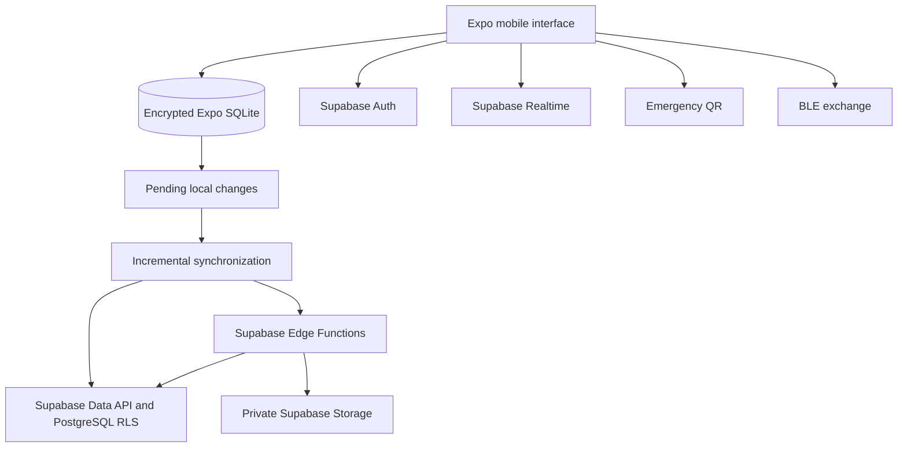

# MediScan

MediScan provides first responders with a consistent QR-based workflow for retrieving critical emergency information, reducing reliance on device-specific lock-screen procedures.

The project is designed for situations in which a patient is unconscious, non-verbal, distressed, or otherwise unable to communicate. A responder scans the patient's MediScan QR code and receives a structured emergency summary containing the information most relevant to immediate care.

> MediScan is an emergency information and decision-support prototype. It does not replace clinical assessment, authoritative health records, or established emergency procedures.

## Why MediScan?

Modern phones already provide useful emergency-information features. Apple supports a lock-screen [Medical ID](https://support.apple.com/guide/iphone/set-up-and-view-your-medical-id-iph08022b192/ios), while Android supports lock-screen [emergency information](https://support.google.com/android/answer/9319337?hl=en). MediScan complements these features rather than attempting to replace them.

Its primary contribution is a consistent patient-to-responder workflow. Native emergency information can require responders to recognize the device platform and know the corresponding lock-screen navigation. MediScan investigates whether a recognizable scan interaction and a standardized result can reduce the time and uncertainty involved in finding critical information.

MediScan brings together:

- A consistent emergency-summary interface across supported mobile devices.
- Local-first access that does not need to download the patient's profile from Supabase at scan time.
- Allergies, medications, conditions, diagnoses, blood type, transfusion preferences, and emergency contacts in one structured result.
- Encrypted local SQLite storage and queued synchronization for offline use.
- Patient-owned records protected remotely by PostgreSQL Row Level Security (RLS).
- Verified-professional permissions, professional updates, scan history, and audit activity.
- QR-based exchange with BLE-assisted encrypted-envelope delivery for supported workflows.

### Example emergency scenario

A patient is found unable to answer questions. Instead of navigating an unfamiliar phone's emergency menus, a responder opens MediScan and scans the patient's displayed QR code. MediScan presents the same organized emergency-summary layout regardless of the patient's supported device, allowing the responder to locate recorded allergies, medications, conditions, transfusion preferences, and emergency contacts quickly.

The result supports—not replaces—the responder's assessment. Missing information is shown as unrecorded rather than being treated as proof that no allergy, medication, or condition exists.

## Local-first architecture

SQLite is the application's immediate data source. Screens read encrypted local records first; network synchronization runs in the background on relevant lifecycle and connectivity events. Local edits are written immediately, queued while offline, and uploaded when connectivity returns.



The backend uses:

- Supabase Auth for sessions, email verification, and password recovery.
- The Supabase Data API and PostgreSQL RLS for patient-owned data.
- A consolidated incremental-sync PostgreSQL function to reduce client requests.
- Supabase Realtime for change notifications.
- Private Supabase Storage buckets for avatars and professional-application images.
- Edge Functions for privileged or cross-user workflows.
- Application-level encryption for medical payloads and encrypted local SQLite fields.

See [Supabase backend documentation](docs/SUPABASE_BACKEND.md) for provisioning and security details.

## Responsible use and current limitations

- MediScan complements Apple Medical ID and Android Emergency Information; it is not a universal replacement for either feature.
- A responder currently needs MediScan to decode a MediScan encrypted QR payload. A generic QR scanner sees an opaque value.
- The current QR format uses an application-wide shared key. This discourages casual reading but is not patient-specific access control and must not be described as strong confidentiality.
- Patient-entered information may be incomplete, inaccurate, or outdated. The interface must distinguish “none recorded” from a clinically confirmed absence.
- Professional verification records who reviewed or contributed information; it does not guarantee that all profile data is medically complete.
- Device and platform support varies, particularly for native BLE, lock-screen, widget, and quick-settings capabilities.
- Only information necessary for emergency response should be included, following data-minimization principles.
- Service-role credentials, database passwords, and private encryption keys must never be bundled in the mobile application.

## Technology

- Expo SDK 57 and React Native
- Expo Router
- Expo SQLite with encrypted application fields
- TanStack Query with persisted local state
- Supabase Auth, PostgreSQL, Data API, RLS, Realtime, Storage, and Edge Functions
- QR and Bluetooth Low Energy workflows

## Development setup

### Prerequisites

- Node.js and npm
- A Supabase project
- Android Studio/ADB for Android development, or Xcode for iOS development
- A development build for native functionality; Expo Go is not sufficient for every native module used by this project

### Install and configure

```sh
npm install
```

Copy `.env.example` to `.env` and provide the project's public Supabase values:

```env
EXPO_PUBLIC_SUPABASE_URL=https://<project-ref>.supabase.co
EXPO_PUBLIC_SUPABASE_PUBLISHABLE_KEY=<publishable-key>
```

Only the publishable key belongs in an `EXPO_PUBLIC_` variable. Never expose a Supabase service-role key in the app.

Provision a fresh linked Supabase project:

```sh
npx supabase link --project-ref <project-ref>
npx supabase db push
npx supabase functions deploy mediscan-privileged
```

Add `mediscanmobile://auth/callback` to the allowed redirect URLs in Supabase Auth configuration.

### Run locally

Build and launch the native development app on a connected device:

```sh
npm run android
```

For an existing development build, start Metro with:

```sh
npx expo start --dev-client
```

Use `npm run ios` on a supported macOS development environment. Native folders are generated artifacts in this project; read the [development workflow](docs/DEVELOPMENT_WORKFLOW.md) before changing native behavior.

## Verification

Run the project checks:

```sh
npx tsc --noEmit
npm run lint
npm test -- --runInBand
```

Before production use, validate RLS with at least two patient accounts and one verified-professional account. Test registration, email verification, offline boot, local edits, reconnect synchronization, QR/BLE behavior, unauthorized cross-user access, and logout with pending changes.

## Project documentation

- [Supabase backend and security](docs/SUPABASE_BACKEND.md)
- [Development and deployment workflow](docs/DEVELOPMENT_WORKFLOW.md)
- [OTA updates](docs/OTA_UPDATES.md)
- [Navigation and deep-link patterns](docs/NAVIGATION_PATTERNS.md)

## Research framing

The July 2026 capstone paper evaluated a broader system: emergency retrieval, professional verification, clinical updates, privacy controls, and software quality. Its three-specialist heuristic evaluation reported an overall mean of 4.07/5 ("Acceptable"). It did not report a controlled comparison against Apple Medical ID or Android Emergency Information. Therefore, faster retrieval than native features is a hypothesis for follow-up testing, not an established result of that paper.

Professional verification and clinical editing remain relevant to the paper's original objectives. The current Supabase implementation must be re-evaluated against those requirements after the Laravel-to-Supabase migration; an implemented workflow in the old Laravel system is not evidence that the replacement workflow is complete.

For a follow-up retrieval study, useful measures include time to first critical information, interaction count, successful retrieval rate, missed or incorrectly interpreted fields, offline completion rate, and perceived usability. Compare equivalent patient profiles and clearly distinguish an on-phone offline QR from a printed dynamic card that requires connectivity.

A suitable research question is:

> Can a standardized, local-first QR workflow reduce the time and interaction cost required to retrieve critical patient information compared with native smartphone emergency-information interfaces?

See the [research-to-implementation alignment checklist](docs/RESEARCH_ALIGNMENT.md) for claims that need updating and features that need end-to-end validation.
