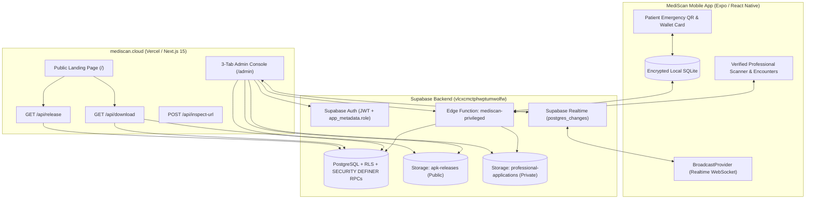
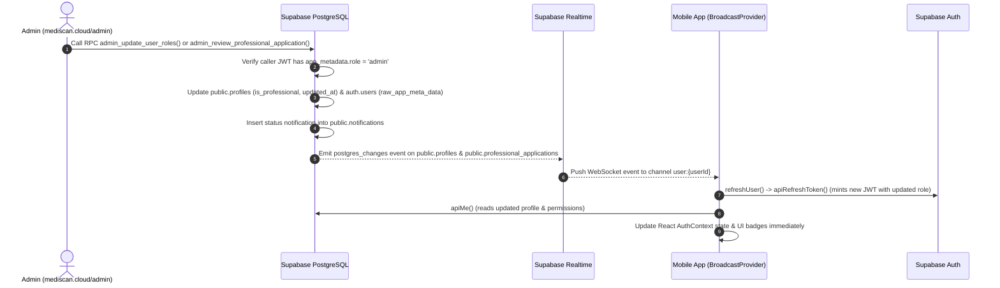
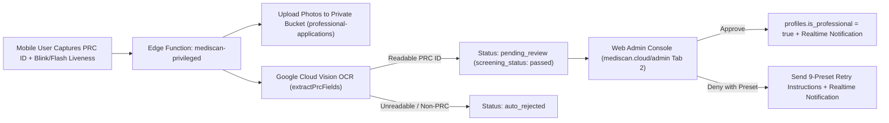

# MediScan System Architecture

This document describes the end-to-end architecture connecting the **MediScan Web Portal & Admin Console (`d:\mediscan-landing`)**, the **MediScan Mobile Application (`d:\mediscan-mobile`)**, and the **Supabase Cloud Backend**.

---

## 1. High-Level Multi-Platform Architecture

MediScan operates across two client surfaces sharing a single **Supabase** backend (`vlcxcmctphwptumwolfw`):
1. **`mediscan.cloud` (Next.js 15 on Vercel):** Public landing page, mobile installer distribution (`/api/download`), and the 3-tab Admin & RBAC Console (`/admin`).
2. **MediScan Mobile App (Expo SDK 57 / React Native):** Offline-first patient emergency pass (`SQLite` + AES-GCM cloud sync) and verified clinician/responder scanner.

---

## 2. Role-Based Access Control (RBAC) Architecture

MediScan enforces a 3-tier role hierarchy across PostgreSQL Row-Level Security (RLS), `SECURITY DEFINER` RPCs, and the `mediscan-privileged` Edge Function:

| Role Tier | Source of Truth in Database | Capabilities |
| :--- | :--- | :--- |
| **1. Standard User (`user`)** | `auth.users` + `public.profiles` (`is_professional = false`) | Manage personal medical profile, allergies, medications, conditions, emergency contacts; generate phone QR (`MEDISCAN:v2:`) and hybrid wallet card (`MEDISCAN:v4:`); submit PRC professional verification application. |
| **2. Verified Professional (`professional`)** | `public.profiles.is_professional = true` & `professional_verified_at IS NOT NULL` | All User capabilities **plus**: scan and audit patient emergency QR passes, record encrypted clinical encounters & vital signs, verify patient records, and create encrypted patient handoffs. |
| **3. System Administrator (`admin`)** | `auth.users.raw_app_meta_data->>'role' = 'admin'` | Full access to `https://mediscan.cloud/admin`: manage all users' RBAC roles, invite new admins, inspect PRC ID & liveness evidence, approve/deny professional applications, and publish Android/iOS app releases. |

---

## 3. Bidirectional Real-Time Role & Verification Sync

When an administrator updates a user's role or reviews a PRC application on `https://mediscan.cloud/admin`, the user's open mobile app updates **live without restarting the app**:

Similarly, the web Admin Console subscribes to `postgres_changes` on `public.profiles`, `public.professional_applications`, and `public.app_releases` via the `web-admin-live` channel so new mobile signups and PRC applications appear automatically in the browser.

---

## 4. PRC Professional Verification Pipeline

---

## 5. Multi-Part Chunked APK Storage & Streaming Architecture

Supabase Free Tier limits individual storage objects to **50 MB**, while the signed `arm64-v8a` Android release APK is **~61.6 MB**. To allow 1-click browser uploads in `/admin` without external hosting:

1. **Browser Chunk Slicing (`/admin`):**
   - Any `.apk` file larger than **42 MB** is automatically sliced in the browser using `File.slice()` into sequential parts (`part0` = 42.0 MB, `part1` = 19.6 MB).
   - Each part is uploaded to the `apk-releases` Supabase Storage bucket and stored as a comma-separated manifest in `public.app_releases.download_url`.
2. **Zero-Buffering Edge Stream Reassembly (`/api/download`):**
   - When a user clicks **Download for Android (.APK)** on `mediscan.cloud`, `GET /api/download` sends parallel `HEAD` requests to sum the exact `Content-Length` (`64,605,557` bytes).
   - It then streams `part0` followed immediately by `part1` through a Web Standard `ReadableStream` with `Content-Type: application/vnd.android.package-archive`, giving Android a single `.apk` file with an accurate download progress bar.
